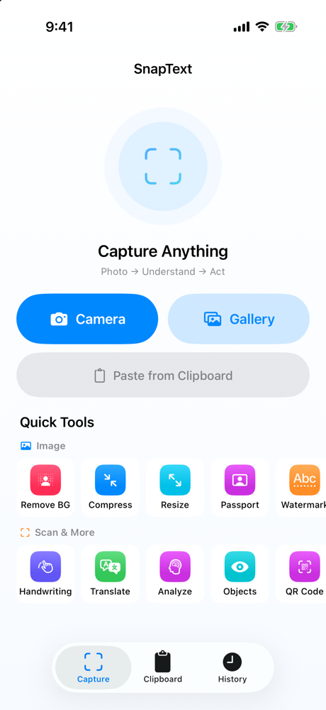
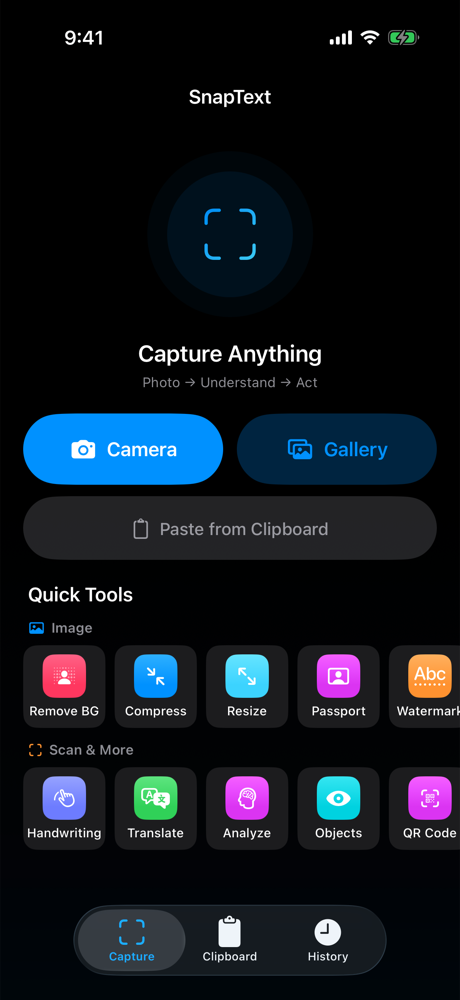

<div align="center">

# SnapText

**Turn anything you can see into text you can use, in one tap.**

Screenshot → Share → SnapText → copied. On-device OCR, smart actions, 27 built-in tools. No account, no servers, no tracking.

[](https://github.com/kashish14/snaptext-ios-ocr/actions/workflows/ci.yml)


[](LICENSE)
[](CONTRIBUTING.md)

</div>

<p align="center">
  
  &nbsp;&nbsp;
  
</p>

---

## Why SnapText

Copying text from a screenshot usually takes five steps across three apps. SnapText cuts that to one:

- **Share Extension auto-copy.** Share a screenshot to SnapText and the text is on your clipboard before the sheet closes.
- **Private by design.** All OCR and detection run on-device with Apple's Vision framework. No image or text leaves your phone.
- **It understands what it reads.** Phone numbers, links, UPI IDs, Wi-Fi credentials, flight numbers, tracking IDs and more become one-tap actions.
- **Zero friction.** No login, no onboarding, no paywall.

## Features

### Capture
| | |
|---|---|
| **Share Extension** | Share any image from Photos, Screenshots or any app. Text is copied instantly |
| **Live Camera** | Full-screen camera with flash and front/back toggle; text is extracted from the shot |
| **Gallery & Batch** | Pick one image or many and extract them all at once |
| **Document Scanner** | Edge detection and perspective correction via VisionKit |
| **QR Scanner** | URLs, Wi-Fi, contacts, plain text |

### Smart Detection
SnapText finds 19 entity types in scanned text and ranks the best action for each:

> phone · email · URL · address · date · UPI ID · tracking number · Wi-Fi · flight number · currency · social handle · IFSC · PAN · Aadhaar · GST · coordinates · order ID · IP address · bank account

Examples: tap a date to create a calendar event, tap a Wi-Fi block to join the network, tap a tracking number to open the right courier's tracker, or save a phone number straight to Contacts.

A rule-based **content classifier** tags each scan as a document, receipt, table, code/JSON or photo, and an **action priority engine** learns which actions you use most and surfaces them first.

### Tools
| Scanners | PDF & Image | Text | Utilities |
|---|---|---|---|
| Smart Analyze | Image → PDF | Word Counter | Unit Converter |
| Object Detector | Doc → PDF | Summarizer | Color Picker |
| Handwriting | Merge PDFs | Compare Texts | Ruler |
| Scan & Translate | Sign Document | JSON Formatter | |
| Receipt | Compress / Resize | Notes from Scan | |
| Table → CSV | Passport Photo | | |
| Website URL | Remove Background | | |
| | Watermark | | |

Plus searchable **scan history** and **clipboard history**, both stored locally with SwiftData.

## Getting Started

### Requirements
- macOS with **Xcode 26.4** or later
- iOS **26.4+** device or simulator

### Build & run
```bash
git clone https://github.com/kashish14/snaptext-ios-ocr.git
cd snaptext-ios-ocr
open SnapText.xcodeproj
```
1. Select the **SnapText** target, open **Signing & Capabilities** and choose your own Team.
2. To run on a real device, change the bundle identifier (`io.github.kashish14.SnapText`) to one you own. Do the same for the **SnapTextShare** extension.
3. Press **⌘R**.

### Run the tests
```bash
xcodebuild test -project SnapText.xcodeproj -scheme SnapText \
  -destination 'platform=iOS Simulator,name=iPhone 17 Pro'
```
Or press **⌘U** in Xcode.

### Try the Share Extension
Run the app once, take a screenshot in the simulator (**⌘S**), open it in Photos, tap **Share** and pick **SnapText**.

## Architecture

SwiftUI + MVVM with a thin service layer. Everything runs offline.

```
Share Extension ─┐
Camera / Gallery ┼─▶ OCRService (Vision) ─▶ SmartDetector ─▶ ContentClassifier ─▶ ActionPriorityEngine ─▶ UI
QR / Doc Scanner ┘                                                                    ▲
                                                               UserBehaviorTracker ───┘
                              SwiftData: ScanHistoryItem · ClipboardItem
```

See [docs/ARCHITECTURE.md](docs/ARCHITECTURE.md) for the full breakdown and folder map.

## Privacy

- No network calls for any core feature. The only time SnapText goes online is when *you* tap a link or tracker.
- No analytics, no third-party SDKs, no accounts.
- Scan and clipboard history live in the app's local SwiftData store and can be cleared at any time.

## Roadmap

Highlights: home-screen widget, history sync via App Groups, Live Text-style selection on images, iPad/visionOS polish, and more languages. Full plan with status: [ROADMAP.md](ROADMAP.md). Product vision and principles: [docs/PRODUCT.md](docs/PRODUCT.md).

## Contributing

Contributions are very welcome, from typo fixes to new detectors and tools. Start with [CONTRIBUTING.md](CONTRIBUTING.md), then pick an item marked *help wanted* in the [roadmap](ROADMAP.md) or open an issue.

Please follow the [Code of Conduct](CODE_OF_CONDUCT.md). Found a security issue? See [SECURITY.md](SECURITY.md).

## Author

Built by **Kashish Agarwal** ([@kashish14](https://github.com/kashish14)). If SnapText saves you a few taps, a ⭐ helps others find it.

## License

[MIT](LICENSE) © 2026 Kashish Agarwal
